# Unity 实时视觉特效开发作品集

这是一个基于 Unity URP 的实时视觉特效开发项目。我以 Ellen 角色和独立特效实验场景为载体，完成了从效果拆解、Shader 编写、材质参数设计、粒子分层、角色挂点绑定到时序控制和运行时验证的一整套流程。

项目由 11 个可以独立运行的 Play Mode 场景组成。每个效果都能播放、暂停、跳转、重置和循环，面试时可以直接打开工程查看材质、粒子、角色动画和脚本之间的关系，展示效果表现和实现过程。

## 项目能力

- 使用 Shader Graph、ShaderLab 和 HLSL 完成溶解、冰冻、能量、电弧、全息、水面和深度交界等实时材质。
- 使用粒子系统、LineRenderer、程序化网格、RenderTexture 和灯光反馈，搭建从预警、蓄能、释放到命中的完整效果链。
- 使用世界空间数据和骨骼挂点，让火焰、电弧、斩击、受击闪光和角色动作保持稳定绑定，不依赖固定摄像机角度。
- 使用 Scene Depth、透明排序、软粒子和深度淡出解决特效与地面、角色、水面的交界问题。
- 使用统一的时间驱动器复现材质参数、粒子事件、动画姿态和灯光强度，保证效果可以准确重播和调试。

## 技术栈

| 类别 | 技术 |
| --- | --- |
| 引擎与渲染 | Unity 6000.0.40f1、URP 17、Renderer Feature、后处理 |
| Shader | Shader Graph、ShaderLab、HLSL、透明渲染、深度采样、顶点位移、噪声与溶解 |
| 运行时 | C#、MaterialPropertyBlock、PlayableGraph、AnimationClip、RenderTexture |
| 特效系统 | Particle System、LineRenderer、程序化 Mesh、骨骼挂点、确定性粒子重演 |
| 调试方式 | Play Mode 时序验证、材质参数检查、粒子生命周期检查、运行时截图采集 |

## 特效展示

| 场景 | 效果内容 | 重点技术 |
| --- | --- | --- |
| `ReactiveShield` | Ellen 受到三处连续攻击，护盾表面出现蜂窝受击波、冲击飞行轨迹和余波 | 多受击点数据、世界空间波纹、边缘发光、粒子清理 |
| `CrystalCollapse` | 角色被晶体包裹后，晶体生长、破碎并在边缘产生溶解发光 | 多层晶体材质、溶解阈值、碎片运动、动作时序 |
| `CryoFreeze` | 冰晶从地面向角色周围生长，随后进入融解阶段 | 冰面法线、透明度、反射探针、程序化冰晶布局 |
| `ElectricOverload` | 三个能量核心在角色周围积蓄电力，并沿身体接触点释放电弧 | LineRenderer 电弧、噪声扰动、接触闪光、局部灯光 |
| `HologramMaterialize` | Ellen 以扫描线和信号扰动的方式逐步显现 | 网格叠加、扫描线、噪声抖动、透明排序 |
| `ArcaneChargeShot` | 掌心蓄能、能量束连接、火球飞行并在命中时爆发 | 蓄能阶段、弹道、火球材质、碎片与烟尘分层 |
| `GroundSlash` | 角色释放贴地斩击，地面留下裂缝、刀光和冲击尘雾 | 斩击带、地面切痕、飞行刀光、手部挂点 |
| `MeteorStrike` | 陨石从空中进入预警区，落地后产生火焰、碎石、烟尘和冲击波 | 飞行轨迹网格、预警圈、碰撞粒子、落点生命周期 |
| `WaterShockwave` | 物体落入水面后产生环形冲击波、飞溅、水滴和泡沫 | 顶点波形、法线扰动、泡沫材质、深度软化 |
| `DepthIntersectionLab` | 对比硬切与软化交界，观察粒子穿过几何体时的深度处理 | Scene Depth、软粒子、交界淡出、参数化对比 |
| `Overheat` | 火焰沿角色骨骼和身体表面附着，并随时间流动 | 火焰卡片、流动噪声、骨骼定位、摄像机朝向 |

## 场景方法与效果展示

每个场景都按照“效果目标 → 主要方法 → 运行结果”的顺序整理。GIF 展示的是场景在 Unity Play Mode 中的实际运行效果。

### 1. ReactiveShield：受击护盾

**主要方法：** 使用 Shader Graph 制作蜂窝护盾表面，C# 将三个世界空间受击点、半径和衰减时间写入材质；HLSL 计算局部冲击波和接触亮度，再叠加飞行冲击物、命中闪光和延迟余波粒子。

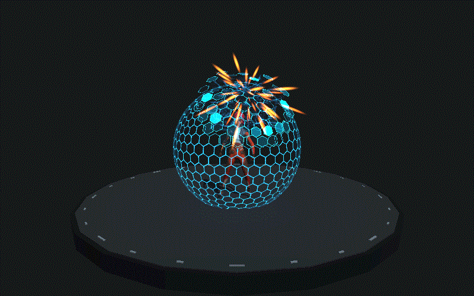

这个场景重点展示多受击点数据如何从运行时传入 Shader，以及透明护盾、粒子和灯光如何形成连续的受击反馈。

### 2. CrystalCollapse：晶体坍塌

**主要方法：** 使用世界空间溶解阈值控制晶体显隐，用边缘发光强化断裂轮廓；脚本按统一时间线生成破碎碎片并混合角色动作，使晶体从包裹、生长到坍塌完整收束。

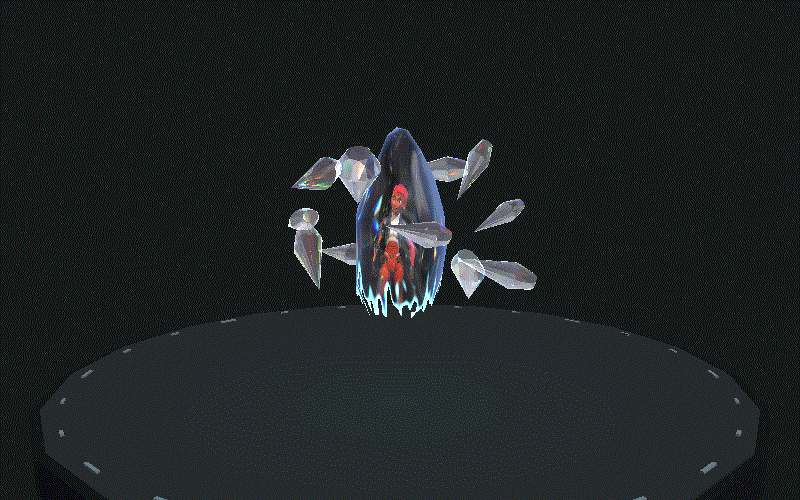

这个场景重点展示溶解材质、碎片运动、角色动画和粒子生命周期之间的时序配合。

### 3. CryoFreeze：冰冻生长

**主要方法：** 使用透明冰材质、法线扰动、反射探针和程序化冰晶布局，让冰晶从地面向角色周围逐层生长；融解阶段通过同一时间参数反向控制高度和透明度。

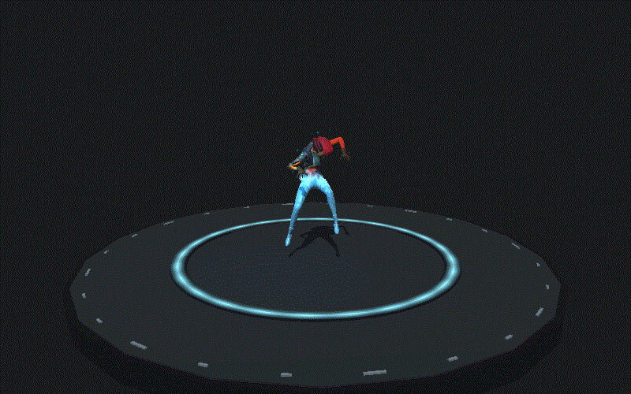

这个场景重点展示透明冰面、镜面反射、地面生长和融解动画的组合方式。

### 4. ElectricOverload：电弧过载

**主要方法：** 使用三个能量核心、两组旋转轨道和 LineRenderer 电弧构成蓄能结构；接触点通过骨骼位置实时计算，电弧宽度、分支透明度、闪光和局部灯光由能量曲线统一控制。

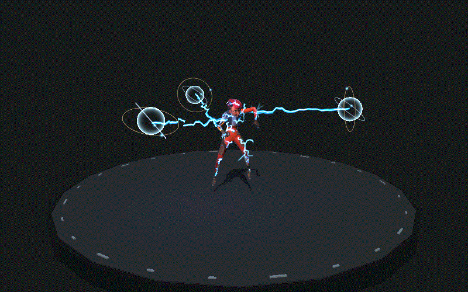

这个场景重点展示程序化电弧、噪声扰动、角色接触点绑定和能量强度反馈。

### 5. HologramMaterialize：全息材质化

**主要方法：** 将扫描线、网格、噪声抖动、边缘高亮和显隐阈值叠加到透明材质中，配合深度测试和透明排序处理角色逐步显现时的遮挡关系。

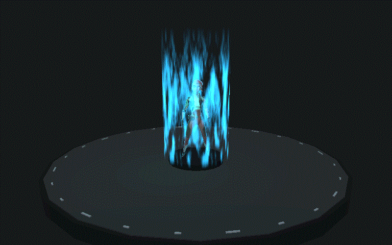

这个场景重点展示全息信号扰动、透明渲染状态和角色轮廓保持之间的平衡。

### 6. ArcaneChargeShot：蓄能火球

**主要方法：** 把效果拆成掌心蓄能、能量束连接、火球发射、飞行和命中五个阶段；每个阶段分别控制材质强度、粒子发射、轨迹和灯光，使释放节奏可以精确调整。

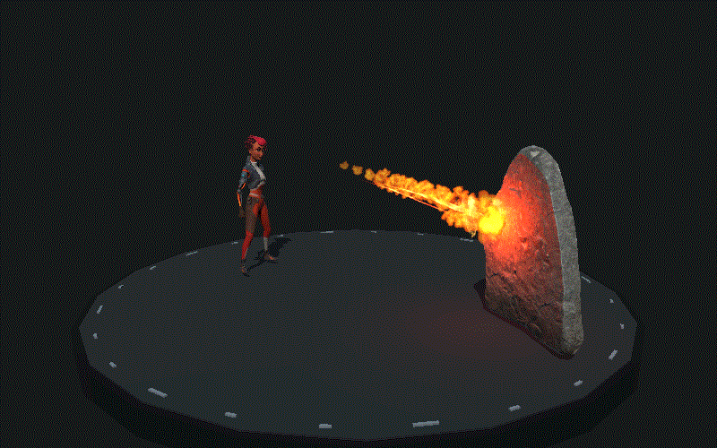

这个场景重点展示多阶段时序、弹道表现、火球材质以及碎片和烟尘的分层。

### 7. GroundSlash：地面斩击

**主要方法：** 使用程序化网格生成连续斩击带，用地面切痕材质表现裂缝和热边缘，再叠加飞行刀光、冲击尘和碎片；释放点跟随角色手部挂点，避免效果漂移。

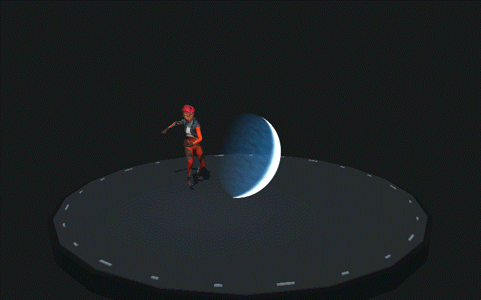

这个场景重点展示轨迹网格、角色挂点、地面交界和粒子冲击的组合。

### 8. MeteorStrike：陨石打击

**主要方法：** 使用预警圈提示落点，用程序化历史带生成飞行尾迹；命中时同时触发落点闪光、火焰、碎石、烟尘、冲击波和冷却地面，并为各层设置独立生命周期。

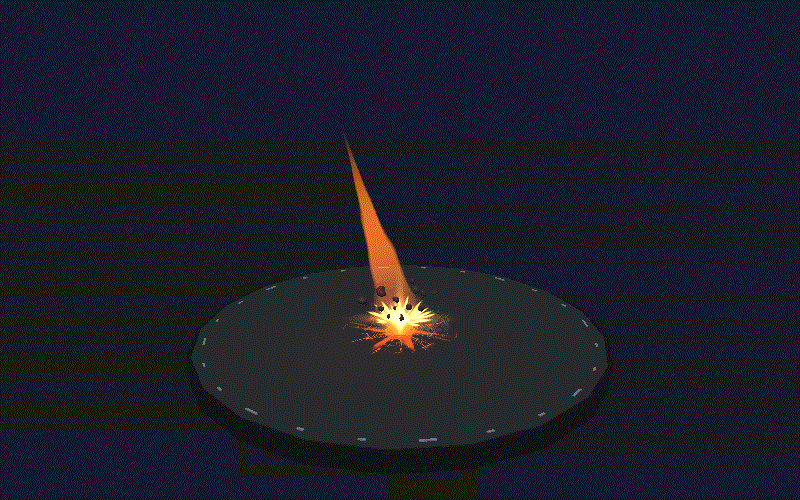

这个场景重点展示从预警、飞行到命中的完整特效链，以及碰撞粒子和生命周期管理。

### 9. WaterShockwave：水面冲击波

**主要方法：** 水面 Shader 使用顶点位移和法线扰动制造波形，脚步或落点通过属性数组写入交互位置；泡沫、水滴、飞溅和冲击环由粒子与透明材质叠加，Scene Depth 用于软化水面和角色的交界。

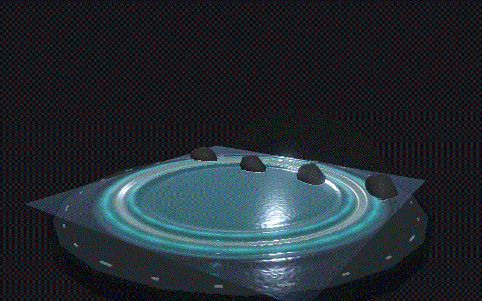

这个场景重点展示角色与水面的空间交互、顶点级波动、深度软边和粒子反馈。

### 10. DepthIntersectionLab：深度交界实验

**主要方法：** 对比硬切和软化两种交界模式，使用 Scene Depth 计算粒子与几何体的距离，并通过软粒子参数控制淡出范围和交界宽度。

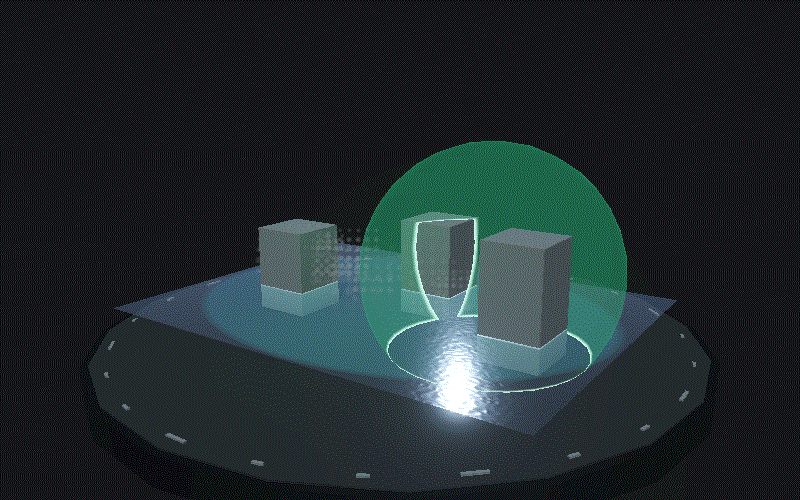

这个场景重点展示深度采样、软粒子和透明物体交界问题的可视化调试方法。

### 11. Overheat：过热燃烧

**主要方法：** 使用流动噪声和火焰遮罩驱动卡片材质，把火焰绑定到角色骨骼和身体表面；每帧根据摄像机方向修正卡片朝向，并把时序参数传入材质控制火焰流动。

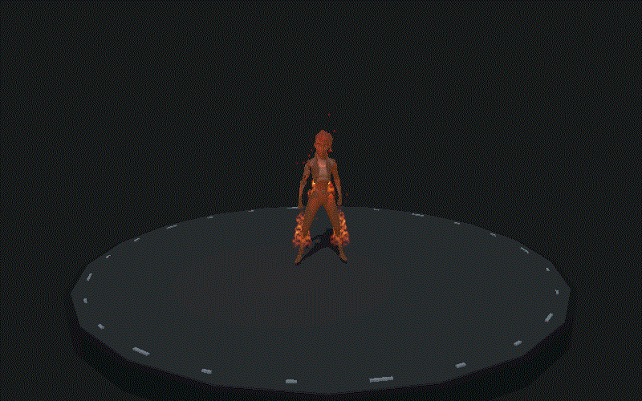

这个场景重点展示骨骼挂点、摄像机朝向、火焰卡片和流动噪声的结合。

## 核心实现

### Shader 与材质

- 使用 Shader Graph 构建火焰、护盾、晶体、冰冻、全息、陨石和水面材质，统一暴露时间、强度、半径、溶解度、命中点和颜色参数。
- 使用 HLSL 处理多受击点波纹、世界空间距离衰减、Scene Depth 采样和水面交界软化，把重复计算封装成可复用的 SubGraph 和函数。
- 根据效果需要控制 Blend、ZWrite、ZTest、Render Queue 和透明排序，保证能量层、粒子层、地面层和角色层按照正确顺序合成。

### 时序与运行时

`FXSequenceDriver` 作为统一时钟，驱动 AnimationClip、材质属性、粒子事件、角色姿态、LineRenderer 和灯光强度。它支持 Play、Pause、Seek、Reset 和循环播放，暂停或跳转时会重新模拟粒子，保证画面可以重复得到相同结果。

`MaterialPropertyBlock` 用于向每个 Renderer 传递实例参数，避免复制材质；`PlayableGraph` 用于混合待机、攻击和动作片段，并关闭根运动，保证角色动作和特效位置保持一致。

### 交互与空间绑定

水面交互会检测角色脚部与水面高度、移动速度和步频，在命中位置写入波纹数据并生成飞溅粒子。火焰、电弧、受击闪光和斩击释放点都通过骨骼或挂点计算世界空间位置，同时根据摄像机方向修正卡片朝向。

### 稳定性与性能

粒子使用固定随机种子，运行时生成的临时 Mesh、材质和粒子对象在场景退出时统一清理；渲染器关闭阴影和不必要的碰撞，降低透明特效的额外开销。每个场景都经过循环播放、暂停、跳转、重置和粒子清理检查。

