# Unity 实时视觉特效作品集

本作品集收录了我使用 Unity 通用渲染管线（URP）制作的 27 个实时特效，涵盖战斗反馈、角色表现、材质与环境渲染。每项作品配有运行实录 GIF，并列出形成画面效果的主要方法。

| 技术方向 | 代表作品 | 实现重点 |
| --- | --- | --- |
| 战斗与交互反馈 | 受击护盾、蓄能火球、陨石打击 | 将命中位置传入 Shader，让粒子、灯光和角色动作按释放时序衔接 |
| 角色与材质表现 | 旗帜烧蚀、水晶切面、角色换装、海瑟音 NPR | 用顶点动画纹理还原布面起伏，用视差偏移表现晶体内部层次，通过 Animator 同步换装前后的动作 |
| 水面与环境渲染 | 水面冲击波、落日海面、雨夜霓虹街道 | 以顶点位移塑造波形，用流动法线扰动倒影，并通过深度采样处理水面交界 |

## 作品展示

### 01. 受击护盾

Ellen 受到三处连续攻击，护盾表面出现蜂窝受击波、冲击飞行轨迹和余波。

- **蜂窝材质与命中数据**　使用 Shader Graph 制作蜂窝护盾表面，C# 将三个世界空间受击点、半径和衰减时间写入材质。
- **局部波纹与余波**　HLSL 计算局部冲击波和接触亮度，再叠加飞行冲击物、命中闪光和延迟余波粒子。

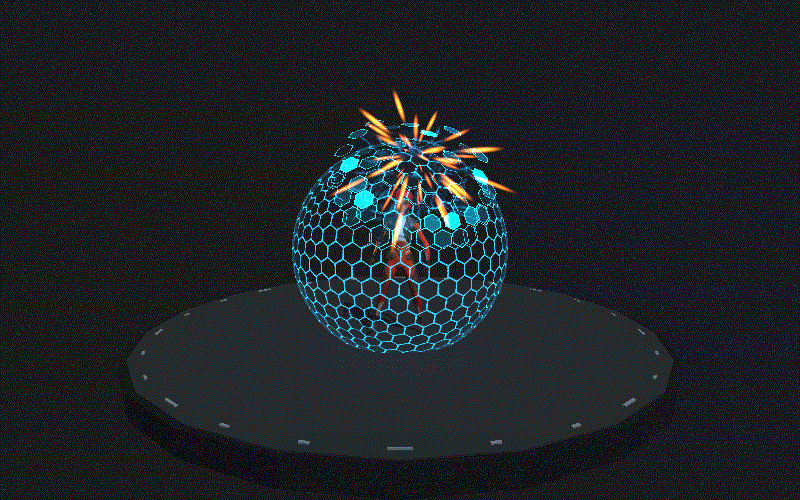

### 02. 晶体坍塌

角色被晶体包裹后，晶体生长、破碎并在边缘产生溶解发光。

- **世界空间溶解**　使用世界空间溶解阈值控制晶体显隐，用边缘发光强化断裂轮廓。
- **碎片与角色时序**　脚本按统一时间线生成破碎碎片并混合角色动作，使晶体从包裹、生长到坍塌完整收束。

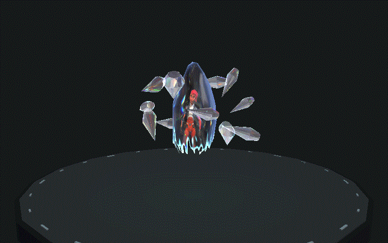

### 03. 冰冻生长

冰晶从地面向角色周围生长，随后进入融解阶段。

- **冰面材质与冰晶布局**　使用透明冰材质、法线扰动、反射探针和程序化冰晶布局，让冰晶从地面向角色周围逐层生长。
- **融解控制**　融解阶段通过同一时间参数反向控制高度和透明度。

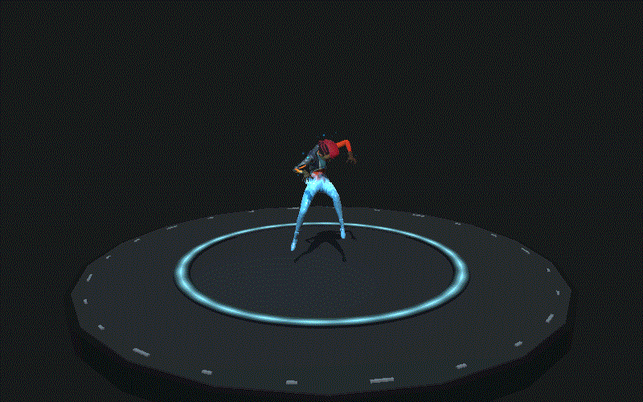

### 04. 电弧过载

三个能量核心在角色周围积蓄电力，并沿身体接触点释放电弧。

- **电弧与蓄能轨道**　使用三个能量核心、两组旋转轨道和 LineRenderer 电弧构成蓄能结构。
- **骨骼绑定与灯光**　接触点通过骨骼位置实时计算，电弧宽度、分支透明度、闪光和局部灯光由能量曲线统一控制。

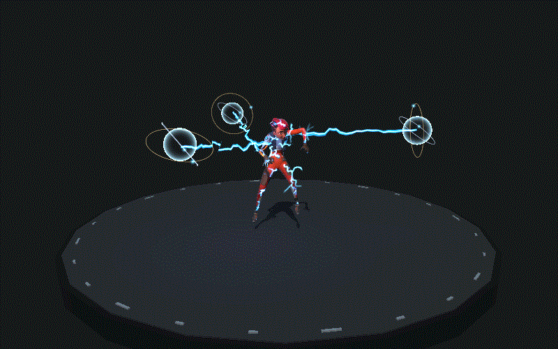

### 05. 全息材质化

Ellen 以扫描线和信号扰动的方式逐步显现。

- **扫描与显隐遮罩**　将扫描线、网格、噪声抖动、边缘高亮和显隐阈值叠加到透明材质中。
- **深度与透明排序**　配合深度测试和透明排序处理角色逐步显现时的遮挡关系。

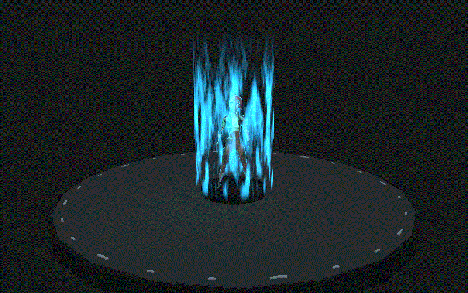

### 06. 蓄能火球

掌心蓄能、能量束连接、火球飞行并在命中时爆发。

- **分阶段时序**　把效果拆成掌心蓄能、能量束连接、火球发射、飞行和命中五个阶段。
- **材质与粒子控制**　每个阶段分别控制材质强度、粒子发射、轨迹和灯光，使释放节奏可以精确调整。

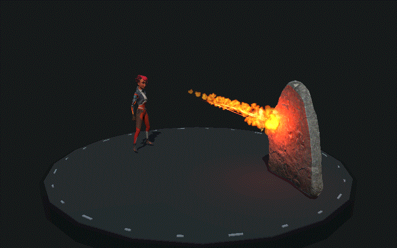

### 07. 地面斩击

角色释放贴地斩击，地面留下裂缝、刀光和冲击尘雾。

- **斩击网格与地面切痕**　使用程序化网格生成连续斩击带，用地面切痕材质表现裂缝和热边缘，再叠加飞行刀光、冲击尘和碎片。
- **手部挂点**　释放点跟随角色手部挂点，避免效果漂移。

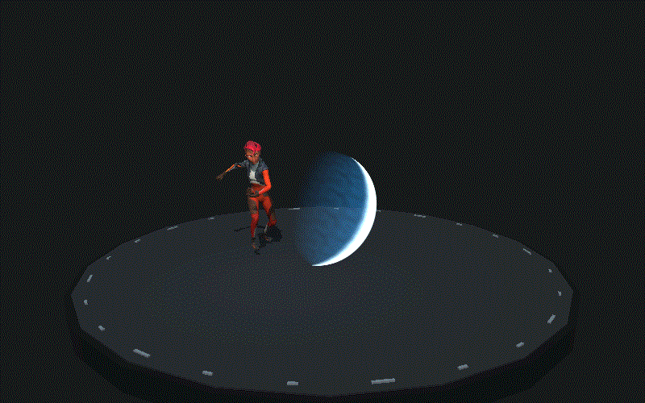

### 08. 陨石打击

陨石从空中进入预警区，落地后产生火焰、碎石、烟尘和冲击波。

- **预警与尾迹**　使用预警圈提示落点，用程序化历史带生成飞行尾迹。
- **命中反馈**　命中时同时触发落点闪光、火焰、碎石、烟尘、冲击波和冷却地面，并为各层设置独立生命周期。

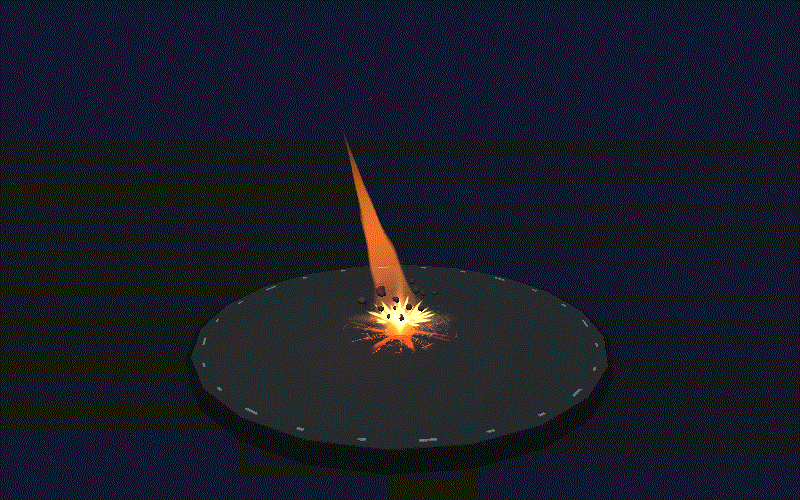

### 09. 水面冲击波

物体落入水面后产生环形冲击波、飞溅、水滴和泡沫。

- **波形与交互位置**　水面 Shader 使用顶点位移和法线扰动制造波形，脚步或落点通过属性数组写入交互位置。
- **泡沫与深度软化**　泡沫、水滴、飞溅和冲击环由粒子与透明材质叠加，Scene Depth 用于软化水面和角色的交界。

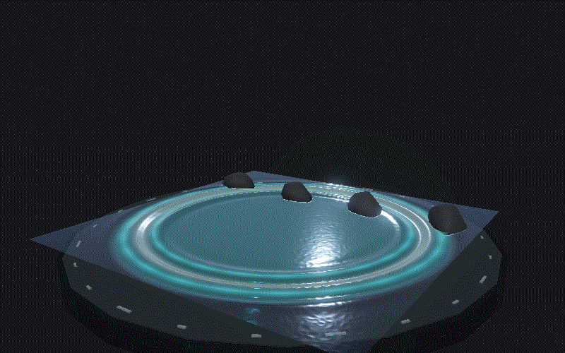

### 10. 深度交界实验

对比硬切与软化交界，观察粒子穿过几何体时的深度处理。

- **深度采样**　对比硬切和软化两种交界模式，使用 Scene Depth 计算粒子与几何体的距离。
- **软粒子与交界淡出**　通过软粒子参数控制淡出范围和交界宽度。

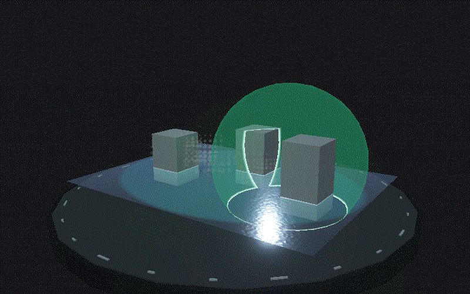

### 11. 过热燃烧

火焰沿角色骨骼和身体表面附着，并随时间流动。

- **火焰材质与骨骼绑定**　使用流动噪声和火焰遮罩驱动卡片材质，把火焰绑定到角色骨骼和身体表面。
- **视角与时序控制**　每帧根据摄像机方向修正卡片朝向，并把时序参数传入材质控制火焰流动。

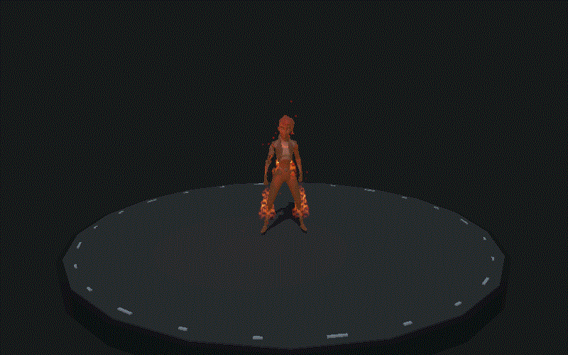

### 12. 角色扫描

青色扫描条纹沿角色身体移动，脸部和衣物的弧度在条纹经过时显现。

- **高度坐标与 UV 滚动**　将表面高度用于扫描纹理采样，用 Time 推进纹理坐标，控制条纹间距和速度。
- **视角边光**　用法线与视线方向的点积生成边缘遮罩，单独调节轮廓光和扫描带的强度。

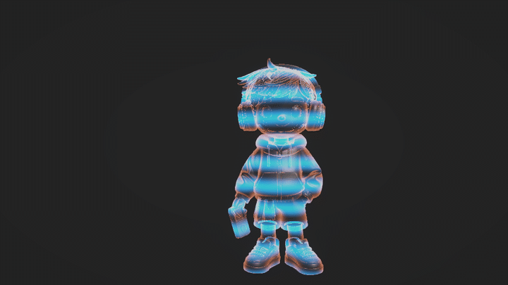

### 13. 甲虫的金属光泽

甲虫转动时，彩色高光沿背甲滑动，在触角和关节上收成细线。

- **MatCap 映射**　将法线转换到观察空间，用法线的 XY 分量采样材质捕捉贴图，使反光跟随表面朝向变化。
- **双层 MatCap 与法线贴图**　基础层提供大块反光，叠加层补充局部亮斑，法线扰动让圆润背甲与细小关节呈现不同的光斑形状。

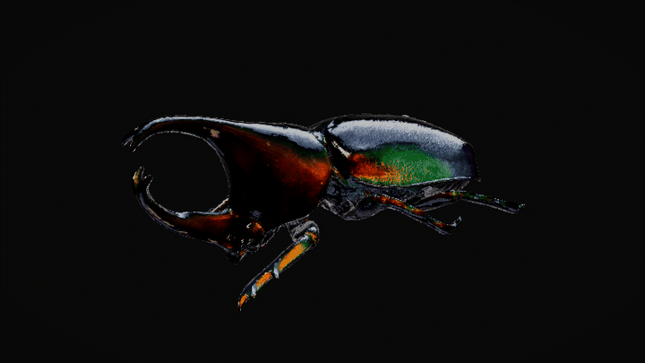

### 14. 藤蔓生长

嫩梢从地面探出，藤条沿弧线伸长、交叠，短暂停留后逐渐收回。

- **UV 生长遮罩**　沿藤条展开的 UV 与 Grow 参数比较，用 Smoothstep 控制生长前沿的过渡宽度。
- **顶点位移与 Alpha Clip**　沿法线改变生长部位的粗细，再裁掉尚未露出的部分，使梢部先细后粗。

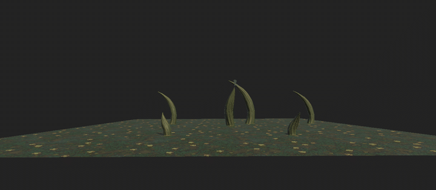

### 15. 火苗与旗帜烧蚀

火苗的尖端分叉摇动，随后旗面正面的纹章被不规则火线逐渐烧穿。

- **噪声扭曲与阈值分色**　滚动噪声扰动火焰 UV，分别用阈值切出内焰、外焰与尖端。
- **顶点动画纹理（VAT）**　随时间采样位置和法线纹理，在顶点阶段还原布面的起伏。
- **噪声溶解与边缘自发光**　用 BurnProgress 推进裁剪阈值，在临界区域叠加焦黑带和炽亮边缘。

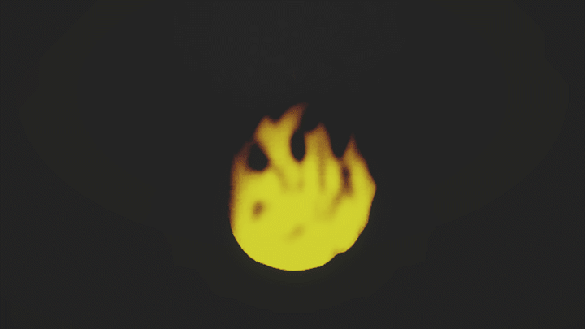

### 16. 水晶切面与内部视差

镜头移动时，长水晶内部的裂纹相对外壳错动，钻石则在相邻切面之间交替闪亮。

- **视差偏移（Parallax Offset）**　用视线方向和 ParallaxDepth 偏移内部纹理的采样坐标，使裂纹看起来位于晶体内部。
- **Cubemap 反射与折射**　根据切面法线计算环境反射方向，钻石的前后表面还使用折射方向采样，形成亮暗相间的切面。

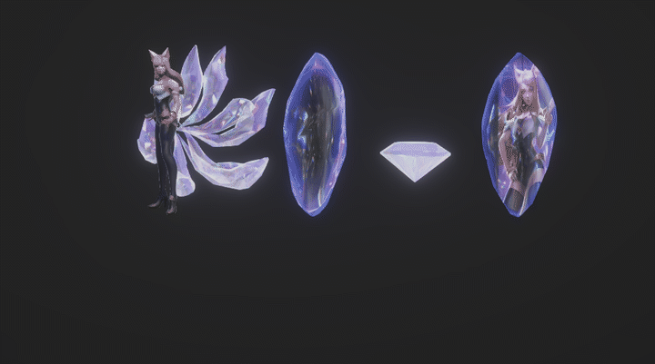

### 17. 金色星流

金色光纹沿角色与飘带流动，从宽阔的亮面收束成细丝。

- **流动贴图与 UV 扰动**　以不同缩放和速度采样 FlowMap 与内部纹理，让表层亮带与暗纹错开。
- **自发光遮罩与菲涅耳边光**　用遮罩控制发光范围，使用 Fresnel 提亮掠射角轮廓，让交错的飘带仍能分辨前后。

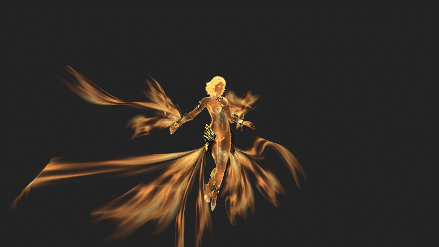

### 18. 透明玻璃杯

镜头绕过玻璃杯时，窗光透过杯壁偏移，杯沿、标志与厚杯底始终可辨。

- **折射近似与厚度贴图**　用折射贴图和厚度遮罩调节环境采样偏移，区分杯壁与杯底的透射观感。
- **内外壁分层与 MatCap**　内外表面分别着色，用视角边光和 MatCap 勾出杯沿，再叠加标志与污渍纹理。

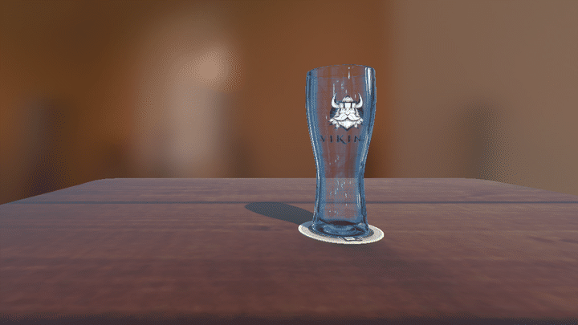

### 19. 软泥怪

粉紫色软泥怪的底缘缓慢起伏，亮纹贴着变形的身体流动。

- **顶点位移**　以位置、流向和时间计算顶点偏移，使身体与底缘产生连续形变。
- **三平面映射与流动法线**　通过 Triplanar 混合不同朝向的采样，再用 Flow Map 和噪声法线扰动高光，表现黏稠表面。

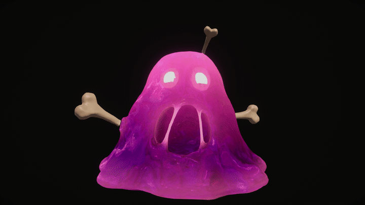

### 20. 角色传送消融

角色从头到脚逐段消失，再沿相反方向显形，青白色碎光标出消融前沿。

- **高度溶解遮罩**　用表面位置、DissolveLevel 与渐变噪声构造不规则阈值，控制消融和重组的方向。
- **顶点偏移与边缘自发光**　在阈值附近拉伸顶点，并提亮窄带遮罩，让正在解体的区域从实体上分离出来。

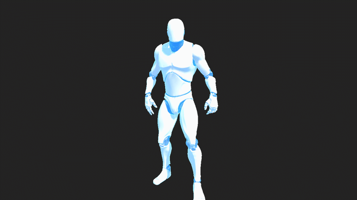

### 21. 全息投影

底座向上投出蓝色人形，扫描纹横穿身体，轮廓随信号轻微抖动。

- **扫描线与故障位移**　滚动扫描纹理，用噪声和抖动频率调制顶点偏移，模拟间歇性的信号扰动。
- **菲涅耳边光与投射光束**　用 Fresnel 勾出人形轮廓，底座光束单独使用滚动自发光和渐隐遮罩。

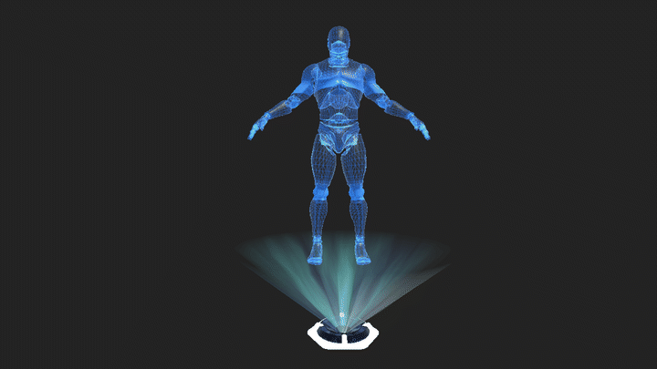

### 22. 受击力场

连续命中球形力场时，亮纹从不同落点扩散，随后淡回原有的球壳纹理。

- **射线检测与粒子数据**　用 Physics.Raycast 定位受击点，以活粒子的位置和尺寸记录各次冲击的中心与范围。
- **MaterialPropertyBlock 与深度交界**　逐帧向渲染器传入命中位置、半径数组和数量，再叠加流动纹理、菲涅耳边光与 Scene Depth 交界光。

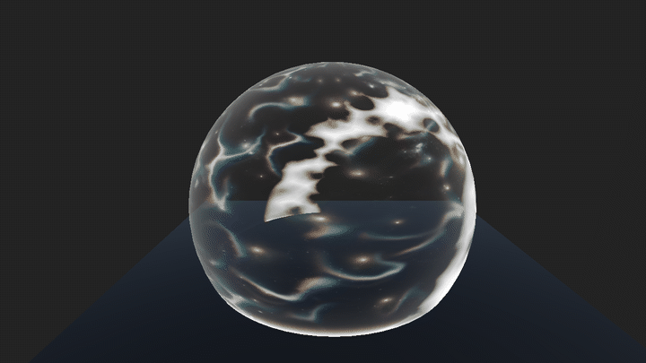

### 23. 六边形能量盾

流光穿过蓝色蜂窝网格，球壳边缘形成一圈更亮的轮廓。

- **六边形遮罩与流光 UV**　用 HexagonMap 提取格线，独立滚动流光贴图与线纹，分别控制网格和亮线的强度。
- **菲涅耳与深度淡化**　用 Fresnel 加亮掠射角轮廓，再结合场景深度与底部渐隐处理护盾和地面的交界。

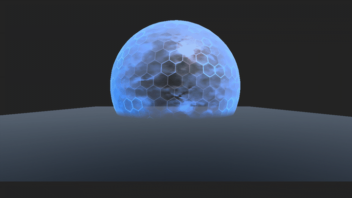

### 24. 动作按钮与角色换装

角色随左侧按钮切换跑步、摆姿、挥手和鞠躬动作，两次点击右上角的服装图标，依次展示金黄、黑色和蓝色三套搭配。

- **UGUI 按钮与 Animator 状态机**　左侧 Button 的 OnClick 调用 Swapper.SetInt，写入 animation 整型参数，驱动角色切换动作。
- **实例切换与动作同步**　服装按钮循环启用下一套角色实例，保留角色朝向，并把当前动作编号传给换装后的 Animator。

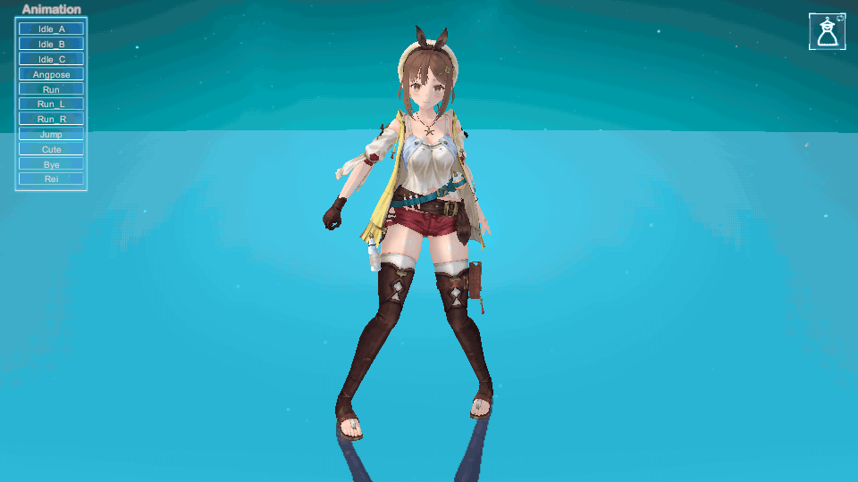

### 25. 落日海面

落日的倒影从地平线延伸到近处，连续的亮带被水面的细波切成闪点。

- **双层滚动法线**　沿不同方向、以不同缩放滚动两组水面法线，通过 Normal Blend 将细波叠到大波纹上。
- **反射纹理与菲涅耳混合**　用扰动后的坐标采样反射纹理，按视角混合水色和反射，再用高光阈值与噪声控制碎光。

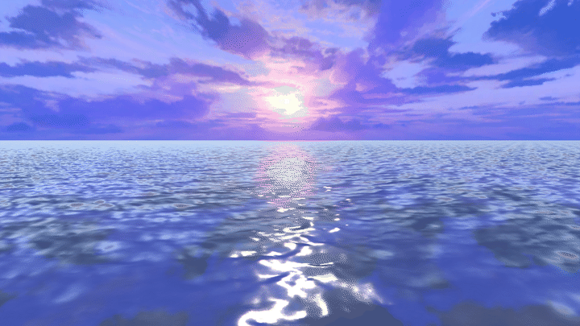

### 26. 雨夜霓虹街道

固定机位下，蓝紫与玫红色招牌倒映在湿砖和水坑中，细小雨纹持续打散倒影。

- **积水遮罩与干湿分层**　将高度图与积水阈值比较，分别控制干砖、潮湿砖面和积水的颜色、平滑度与法线强度。
- **雨滴序列帧与波纹法线**　通过 Flipbook 播放雨滴图集，用 Voronoi、Normal From Height 和流动法线生成水面扰动，打散烘焙反射探针中的霓虹倒影。

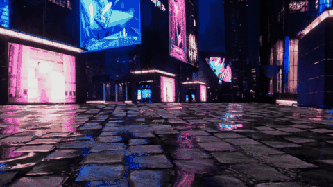

### 27. 二次元角色 NPR 渲染管线（海瑟音）

在 Unity 6（URP 17）下从零搭建的二次元角色实时渲染管线，依次展示脸部全方位阴影、头发天使环、金属与黑珍珠、视差透明水腹、黑丝与披风脉络、双色边缘光描边，以及渲染前后的整体对比。

- **脸部 SDF 与头发高光**　通过 FaceSDF 贴图与主光方位角控制脸部阴影过渡和 UV 翻转，并对眼部区域对称锁值防止斜切；头发使用去高光底图叠加提取遮罩，以球形虚拟法线驱动 Kajiya-Kay 双层天使环。
- **单图多材质与局部特化**　通过线性 ILM 贴图划分皮肤、黑丝、金属、丝绸与水腹区域并映射至多行 Ramp LUT；金属与黑珍珠采用棚拍柔光箱 MatCap，黑丝拆分顶部皮质束带与视角透肤效果，披风脉络叠乘底色实现渐变呼吸发光。
- **视差透明水腹**　基于角色局部空间平面投影避免 UV 镜像，利用视线偏移将上升气泡与水底焦散分层拉开纵深，并配合菲涅尔表现水腔通透感。
- **双色边缘光与平滑法线描边**　按主光方向将硬切菲涅尔分为受光亮边与背光冷反光，头发混入球形法线消除发片断层；C# 分离双面布料并烘焙切线空间平滑法线与分部位权重至 UV3，经 URP Render Objects 输出距离自适应外描边。

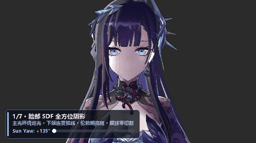

## 工程实现与运行

第 01–11 项对应仓库内可独立运行的 Unity 场景，工程版本为 Unity 6000.0.40f1 / URP 17。在 Play Mode 中可播放、暂停、跳转、重置或循环预览效果。第 12–27 项以 GIF 和技术说明收录。

### Shader 与材质

- 使用 Shader Graph 构建火焰、护盾、晶体、冰冻、全息、陨石和水面材质，统一暴露时间、强度、半径、溶解度、命中点和颜色参数。
- 使用 HLSL 处理多受击点波纹、世界空间距离衰减、Scene Depth 采样和水面交界软化，把重复计算封装成可复用的 SubGraph 和函数。
- 根据效果需要控制 Blend、ZWrite、ZTest、Render Queue 和透明排序，保证能量层、粒子层、地面层和角色层按照正确顺序合成。

### 时序与运行时

`FXSequenceDriver` 作为统一时钟，驱动 AnimationClip、材质属性、粒子事件、角色姿态、LineRenderer 和灯光强度。它支持 Play、Pause、Seek、Reset 和循环播放，暂停或跳转时会重新模拟粒子，保证画面可以重复得到相同结果。

`MaterialPropertyBlock` 用于向每个 Renderer 传递实例参数，避免复制材质；`PlayableGraph` 用于混合待机、攻击和动作片段，并关闭根运动，保证角色动作和特效位置保持一致。

### 交互与空间绑定

水面交互会检测角色脚部与水面高度、移动速度和步频，在命中位置写入波纹数据并生成飞溅粒子。火焰、电弧、受击闪光和斩击释放点都通过骨骼或挂点计算世界空间位置，同时根据摄像机方向修正卡片朝向。

### 稳定性与性能

粒子使用固定随机种子，运行时生成的临时 Mesh、材质和粒子对象在场景退出时统一清理；渲染器关闭阴影和不必要的碰撞，降低透明特效的额外开销。每个场景都经过循环播放、暂停、跳转、重置和粒子清理检查。
